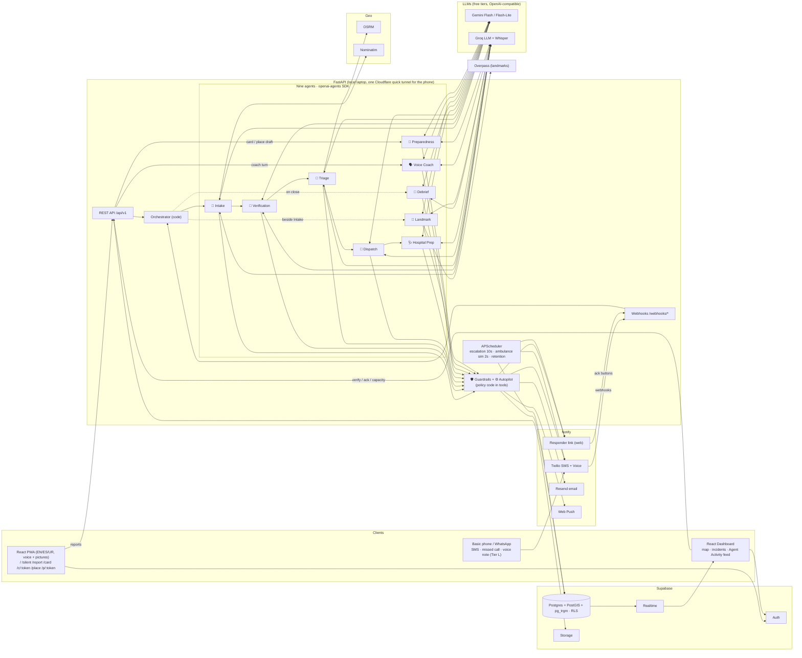
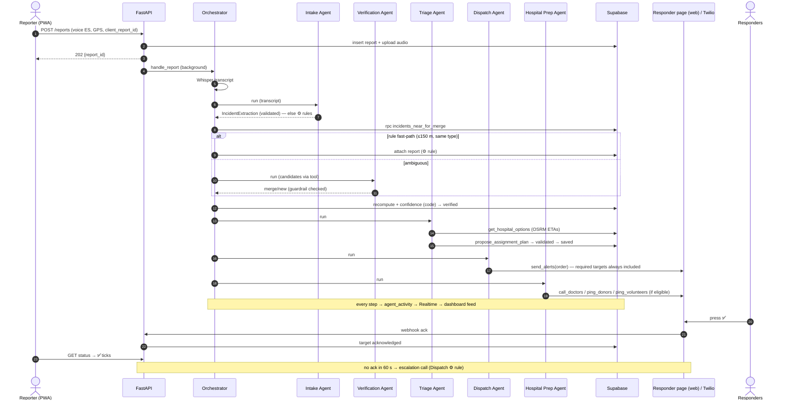
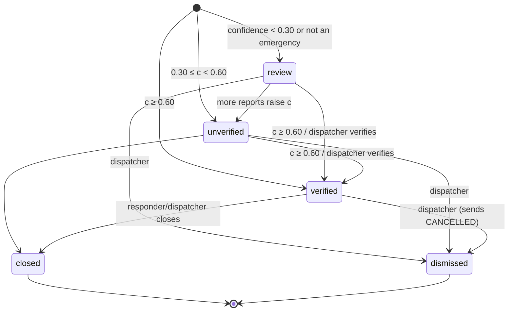
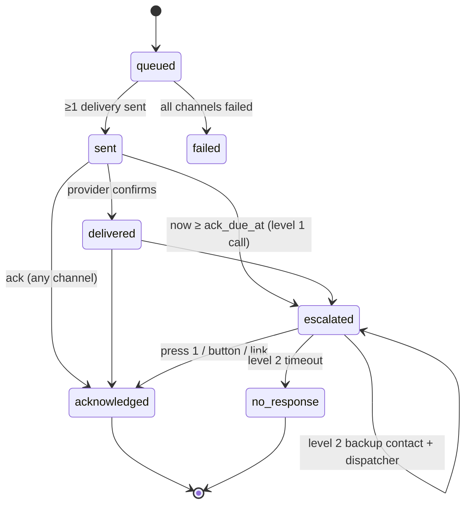
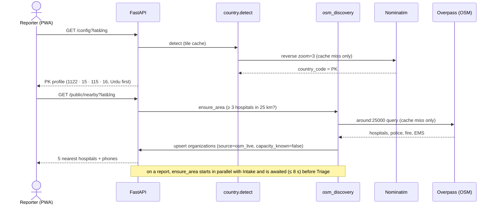

# 04 — System Architecture: Golden Minute

Diagrams are Mermaid (render on GitHub, VS Code, or mermaid.live).

---

## 0. Animated version

Open `docs/architecture.html` in a browser for an animated walkthrough of the same flow
(report → nine agents → responders → acknowledgements; card scan; voice coach). The Mermaid diagrams below are the
precise reference.

## 1. Component diagram



## 2. Main sequence: report → agents → alert → acknowledge



## 3. Incident state machine


Automatic transitions only move "up" (review → unverified → verified).

## 4. Alert target state machine (with escalation)


Donor/volunteer/public targets have `ack_due_at = null` and stop at `sent`/`delivered`.

## 5. Escalation job (`jobs/escalation.py::tick`, every 10 s)

```sql
-- selection query (via supabase rpc or PostgREST filter)
select * from alert_targets
where status in ('sent','delivered','escalated')
  and ack_due_at is not null and ack_due_at <= now()
  and incident_id in (select id from incidents where status in ('unverified','verified'))
order by ack_due_at limit 20;
```
For each row (process sequentially; each step is idempotent via `escalation_level`):

| escalation_level | Action | Then |
|---|---|---|
| 0 | `notify_twilio.call(target, primary)`; incident_event `escalated` | level=1, status=`escalated`, `ack_due_at = now()+60s` |
| 1 (org) | call + responder-link notice to backup contact; dashboard notice to dispatcher target(s) | level=2, `ack_due_at = now()+60s` |
| 1 (doctor) | create target for next-priority doctor of same specialty and send | level=2, status `no_response`, `ack_due_at=null` |
| 2 | status=`no_response`, `ack_due_at = null`, incident_event `no_response` | stop |

## 6. Dispatch flow (`agents/orchestrator.py` + `services/dispatch.py`)

```
on IncidentChange (status up, or significant update):
  Triage Agent → plan (validated)          | ⚙ matching.spread()
  required = dispatch.required_targets(incident)      # policy table PRD F-10 (code)
  Dispatch Agent → order of keys           | ⚙ dispatch.default_order(required)
  send_targets(keys): missing required keys auto-appended; unknown keys rejected
  if significant update: send_update() to existing targets ("🔄 UPDATE")
  if verified: Hospital Prep Agent         | ⚙ every eligible action
  else if unverified and ambulance needed and no ongoing danger: ping_volunteers (⚙ rule)
  if verified and SIMULATION_ENABLED: assign ambulances (code)
  incidents.first_alert_at = first successful delivery time
```
Targets are created with `insert … on conflict do nothing` on the unique recipient index;
deliveries are sent only when the insert created the row (no duplicates on re-runs).

## 7. Ambulance simulation (`jobs/ambulance_sim.py::tick`, every 2 s)

```
for amb in ambulances where status != 'available':
   step_m = SIM_SPEED_KMH * 1000/3600 * SIM_TICK_S
   en_route_*: route_progress_m += step_m; position = interpolate(route, progress)
              (use shapely? NO — write a 20-line linear interpolation over the LineString
               coords with geopy.distance.distance for segment lengths)
              if progress ≥ route_length → next stage
   at_scene: after 30 s → fetch route scene→destination hospital → en_route_hospital
   at_hospital: after 30 s → available, clear incident, location stays
emit incident_event on stage changes; Realtime pushes row updates to dashboard
```
(Interpolation is small custom code because no listed library does it; this is allowed —
see AGENTS.md "custom code only for glue and unique logic".)

## 8. Run topology (local only — no deployment in this build)

| Piece | Where | Notes |
|---|---|---|
| Frontend | `npm run dev` on `localhost:5173` | Vite dev server **proxies** `/api` and `/webhooks` to `localhost:8000` (`vite.config.ts` `server.proxy`) and allows the tunnel host (`server.allowedHosts: ['.trycloudflare.com']`), so the browser only ever talks to one origin |
| Backend | `uvicorn app.main:app --reload --port 8000` on the laptop | one instance (scheduler) |
| Phone access | `cloudflared tunnel --url http://localhost:5173` → one `https://….trycloudflare.com` URL | HTTPS is required for microphone, GPS and camera on a phone. The same URL carries the responder links (`/r/<token>`) and QR codes (and the Telegram webhook only if `TELEGRAM_ENABLED`) |
| DB/Auth/Storage | Supabase free project | the only cloud piece besides the LLM APIs |
| Responder links | `python -m scripts.demo_links` prints `{PUBLIC_BASE_URL or http://localhost:5173}/r/<token>` for the demo hospital and police | Re-run after the tunnel URL changes (links expire after 6 h). Optional Telegram: `scripts/set_telegram_webhook.py`, only when `TELEGRAM_ENABLED=true` |
| QR codes | encode `{PUBLIC_BASE_URL}/c/{token}` and `/p/{token}` | printed stickers printed during the demo only work while this tunnel URL is alive — for the demo print them after the tunnel starts |
| Twilio / WhatsApp / Resend | **not used in the 3-hour build** (Tier L) | |

## 8.1 Location-aware flow (F-35)



## 9. Failure handling matrix

| Failure | Behaviour |
|---|---|
| Primary model down / 429 | agent retried on its fallback model (other provider); 60 s provider cooldown |
| Both models fail / invalid output | ⚙ autopilot for that agent (rules classifier, distance rule, spread(), default order, all eligible prep actions, template debrief) |
| Whisper down | report kept with audio; extraction from SOS default + follow-up question asking to type |
| OSRM down | haversine ETA at 25 km/h |
| Nominatim down | label = hint or coordinates |
| Web responder page unreachable | the alert still exists as an `alert_targets` row + `dashboard` delivery; responders can open the dashboard; escalation still runs. (Optional Telegram send fails: delivery `failed`, dashboard channel unaffected) |
| Twilio fails | delivery `failed`; responder-link/email still sent |
| All channels fail for a target | target `failed`; dispatcher sees red chip; incident_event `alert_failed` |
| Backend restarts | jobs resume from DB state; pending reports with status `received`/`processing` older than 2 min are re-queued at startup |
| Reporter offline | IndexedDB queue + idempotent `client_report_id` |
| Country lookup fails | fallback profile (`COUNTRY_PROFILE`) + a `112` button always shown |
| Overpass landmark query fails (F-38) | incident keeps coordinates + area label; alerts are not delayed; retry once after 30 s and send an UPDATE if it succeeds |
| Landmark Agent output fails validation (F-38) | template line from the same facts |
| Browser has no voice for the language (F-39) | gTTS audio from `GET /api/v1/tts/ui`; if that fails the steps stay on screen with icons |
| Voice Coach Agent down (F-39) | keyword intent classifier; unknown → repeat step + call button |
| Preparedness Agent down (F-40) | guided one-question-per-screen form |
| Card scan on a deleted/deactivated card (F-36) | 404 page "This card is no longer active" + emergency buttons |
| Tunnel URL changed after QR stickers were printed | scan page unreachable; keep the tunnel running during the demo, or print stickers after it starts |
| Overpass down / slow (> 8 s) | Triage uses whatever orgs exist; tile marked `failed`, retried after 10 min; if no hospital within 25 km, dispatcher alerted "no hospitals known near incident" |


## 10. Common-person flows (F-36 … F-42)

### 10.1 Emergency Card: set-up and scan

```mermaid
sequenceDiagram
  autonumber
  actor O as Owner (voice, any language)
  participant FE as PWA /card/new
  participant API as FastAPI
  participant PR as 🪪 Preparedness Agent
  participant DB as Supabase
  actor B as Bystander (phone camera)
  O->>FE: speaks "my name is…, blood O+, brother's number…"
  FE->>API: POST /cards/draft (audio)
  API->>API: Whisper → text → redact phone numbers (<PHONE_1>)
  API->>PR: text with placeholders
  PR-->>API: CardDraft (typed)
  API->>API: restore + validate phones (E.164)
  API-->>FE: draft, read aloud for confirmation
  O->>FE: taps big green Save
  FE->>API: POST /cards (consent_at)
  API->>DB: emergency_cards + card_contacts (phones encrypted)
  API-->>FE: QR sticker page (/card/:id/print)
  B->>API: GET /public/card/{token} (scan)
  API->>DB: card_scans, scan_count+1
  API-->>B: name, blood group, allergies, 🚑 Get help, 📞 Call family
  B->>API: POST /public/card/{token}/alert (GPS)
  API->>DB: report(card_id) → normal pipeline
  Note over API,DB: Dispatch adds the fixed "Card: blood …" line to the hospital brief; family notice (F-41) by template
```

### 10.2 Voice Coach turn

```mermaid
sequenceDiagram
  actor R as Bystander
  participant FE as PWA coach sheet
  participant API as FastAPI
  participant VC as 🗣 Voice Coach Agent
  R->>FE: holds mic: "khoon nahi ruk raha"
  FE->>API: POST /reports/{id}/coach (audio, current card/step)
  API->>API: Whisper → text
  API->>VC: text + current card key + valid card keys
  VC-->>API: CoachTurn {intent, card_key, ack}
  API->>API: validate_turn(); step text read from first_aid.json
  API-->>FE: {say: ack, card_key, step, text}
  FE->>R: speaks ack, then the step text (speechSynthesis / gTTS)
```

### 10.3 Landmark step (beside Intake)

```
report with coordinates → asyncio.gather(
    intake(report),
    landmarks.nearby_landmarks(lat,lng) → Landmark Agent → validate → template fallback )
→ incidents.landmark_text / landmark_local → included in alerts, brief, status page
(if it arrives after the first alert: send_update with the new line)
```
